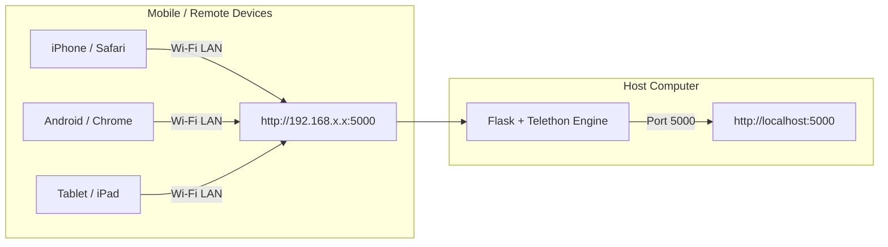

<div align="center">

# ⚡ Telegram Groups, Channels & Bots Cleaner Pro (v1.0)
### *Next-Generation Mobile & Desktop Batch Telegram Account Sanitation Suite*

<p align="center">
  
  
  
  
  
</p>

<p align="center">
  <b>A sleek, high-performance, Glassmorphic Web Dashboard engineered for selectively purging unwanted Telegram broadcast channels, supergroups, and permanently wiping annoying bots with 100% genuine MTProto API execution.</b>
</p>

<p align="center">
  <a href="#-key-features"><b>Key Features</b></a> •
  <a href="#-mobile--network-access"><b>Mobile Wi-Fi Guide</b></a> •
  <a href="#-quick-installation"><b>Installation</b></a> •
  <a href="#-how-it-works"><b>Architecture</b></a> •
  <a href="#-المميزات-الرئيسية-بالعربية"><b>التوثيق العربي</b></a> •
  <a href="#-author--credits"><b>Credits</b></a>
</p>

---

</div>

## 📸 Overview & Highlights

<table>
  <tr>
    <td width="50%">
      <h3 align="center">🎯 Selective Precision Picker</h3>
      <p align="center">Search, filter, and choose specific channels, groups, or bots. No accidental leaves of your important chats.</p>
    </td>
    <td width="50%">
      <h3 align="center">🤖 Triple-Action Bot Wipe</h3>
      <p align="center">Stops the bot (<code>BlockRequest</code>), clears chat history (<code>DeleteHistoryRequest</code>), and removes dialog completely.</p>
    </td>
  </tr>
  <tr>
    <td width="50%">
      <h3 align="center">⚡ Dynamic Speed Controller</h3>
      <p align="center">Presets (Instant, Fast, Safe, Stealth) + <b>Live slider</b> to tune speed on the fly without stopping active tasks.</p>
    </td>
    <td width="50%">
      <h3 align="center">📱 100% Mobile & LAN Ready</h3>
      <p align="center">Fully responsive Dark Glassmorphism UI with auto-generated Wi-Fi URL for iOS, Android, and Termux usage.</p>
    </td>
  </tr>
</table>

---

## ✨ Key Features

- 🛡️ **True MTProto Execution**: Employs official Telegram API functions (`delete_dialog`, `LeaveChannelRequest`, `DeleteChatUserRequest`, `DeleteHistoryRequest`, `BlockRequest`) to ensure real, irreversible removal from your account.
- 🧹 **Triple-Layer Bot Removal (Clear & Wipe)**:
  1. Blocks bot to prevent future spam.
  2. Wipes entire message history in both directions (`revoke=True`).
  3. Deletes conversation from your Telegram chat list.
- 🪟 **Modern Glassmorphic Modals**: Clean confirmation dialogues with item breakdowns (Channels vs Groups vs Bots) — no browser `alert()` or `confirm()`.
- 💾 **Instant Credential Persistence**: Local browser storage (`localStorage`) saves your API configurations across refreshes.
- 📊 **Real-time Telemetry & Log Export**: Dynamic progress bar, live status counters (Cleaned, Skipped/Failed, Total), and single-click `.txt` log exporter.
- 🔔 **Private Bot Alerts**: Integrated Telegram Bot webhook to stream live execution notifications directly to your private chat.
- 🔒 **Zero Telemetry / 100% Private**: Your API ID, Hash, and sessions are kept strictly on your local machine (`localhost`).
- 🔍 **SEO-Ready & Professional**: Semantic meta tags, Open Graph / Twitter cards, JSON-LD structured data, `robots.txt`, `sitemap.xml`, SVG favicon, PWA manifest, and hardened security headers.

---

## ⚡ Speed Preset Modes

| Mode | Delay Range | Recommended Use Case | Flood Risk |
| :--- | :--- | :--- | :--- |
| **⚡ Instant** | `0.0s - 1.0s` | Quick cleanup of a few chats (< 10) | ⚠️ Moderate |
| **🚀 Fast** | `1.0s - 3.0s` | Rapid batch operations (10 - 50 items) | ⚡ Low |
| **🛡️ Safe** *(Default)* | `3.0s - 6.0s` | **Standard accounts & large cleanups (50 - 300 items)** | 🟢 Zero Risk |
| **🐢 Stealth** | `8.0s - 15.0s` | High-value accounts / anti-ban stealth mode | 🟢 Ultra Safe |

> 💡 **Pro-Tip**: You can adjust delays in real-time during execution using the **Live Speed Slider** on the progress dashboard!

---

## 📱 Mobile & Network Access

Run the server on your computer and control everything from your mobile phone on the same Wi-Fi:



1. Launch the server (`run.bat` or `python app.py`).
2. The dashboard will show your local Wi-Fi URL (e.g., `http://192.168.1.50:5000`).
3. Click **Copy** and open that URL on any mobile browser connected to the same Wi-Fi network.

---

## 🚀 Quick Installation

### Prerequisites
* **Python 3.8+** installed ([Download Python](https://www.python.org/downloads/))
* Telegram **API ID** & **API HASH** from [my.telegram.org](https://my.telegram.org)

### 1. Clone & Navigate
```bash
git clone https://github.com/Kero309x/Telegram-Group-Leaver-Pro.git
cd Telegram-Group-Leaver-Pro
```

### 2. Run with One Click
* **Windows**: Double-click `run.bat` or run:
  ```cmd
  python app.py
  ```
* **Linux / macOS / Android Termux**:
  ```bash
  chmod +x run.sh
  ./run.sh
  ```

---

<div dir="rtl">

## 🌟 المميزات الرئيسية (بالعربية)

* 🎯 **تنفيذ حقيقي وفعلي 100%**: خروج ومسح حقيقي من سحابة تليجرام باستخدام دوال MTProto الرسمية بدون أي نتائج وهمية.
* 🤖 **نظام مسح البوتات الثلاثي (Triple Bot Wipe)**:
  1. حظر وإيقاف البوت نهائياً لمنع إرسال أي رسائل (`Block`).
  2. مسح كافة الرسائل وسجل المحادثة من الطرفين (`Revoke & Clear History`).
  3. إزالة الشات من قائمة المحادثات الرئيسية تماماً (`Delete Dialog`).
* 🪟 **نوافذ تأكيد زجاجية أنيقة (Glassmorphism Modal)**: ديالوج تفاعلي يعرض إحصائية دقيقة بالعدد لكل نوع (قنوات، مجموعات، بوتات) قبل تأكيد التنفيذ.
* 📱 **دعم الموبايل وشبكة الواي فاي المنزلية**: تحكم كامل في حسابك من متصفح الهاتف عبر الرابط المحلي الذكي (`http://192.168.x.x:5000`).
* ⚡ **تحكم فوري بالسرعة**: 4 أوضاع سرعة مسبقة + سلايدر مباشر لتغيير السرعة أثناء عمل البرنامج بدون إيقافه.
* 💾 **حفظ تلقائي للبيانات**: حفظ مفاتيح الـ API ورقم الهاتف محلياً داخل المتصفح لعدم تكرار كتابتها.
* 📊 **تصدير السجلات**: إمكانية تصدير التقرير النهائي بضغطة زر كملف نصي (`.txt`).
* 🔍 **SEO احترافي**: وسوم meta كاملة، بطاقات Open Graph و Twitter، بيانات منظمة JSON-LD، `robots.txt`، `sitemap.xml`، أيقونة SVG، وmanifest لتطبيق ويب (PWA).

</div>

---

## 🏗️ Project Architecture

```text
📁 Telegram-Group-Leaver-Pro/
├── 📄 app.py              # Asynchronous Flask Core + Telethon Engine + Glassmorphic UI
├── 📄 requirements.txt    # Python Dependencies (Flask, Telethon, Aiohttp)
├── 📄 run.bat             # Windows 1-Click Auto-Launcher
├── 📄 run.sh              # Linux / macOS / Android Termux Launcher
├── 📄 README.md           # Comprehensive Bilingual Documentation
├── 📄 LICENSE             # MIT License Copyright (c) 2026 Kero309x
└── 📄 .gitignore          # Security rules for credentials & sessions
```

---

## 👨‍💻 Author & Credits

* **Lead Architect & Developer**: **[Kero309x](https://github.com/Kero309x)**
* **GitHub Repository**: [@Kero309x/Telegram-Group-Leaver-Pro](https://github.com/Kero309x/Telegram-Group-Leaver-Pro)

<div align="center">

🌟 **If you find this tool helpful, please consider giving it a Star on GitHub!** 🌟

[](https://github.com/Kero309x)

</div>

---

## 📄 License

This project is open-sourced under the **[MIT License](LICENSE)**. Feel free to use, modify, and distribute with attribution.
